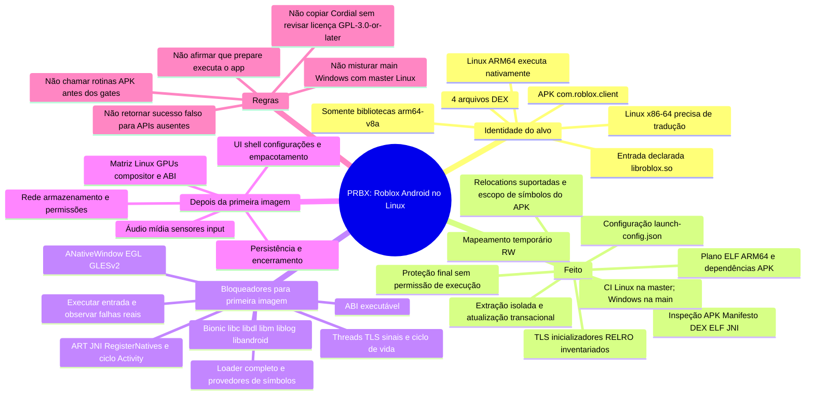

# Mapa mental do PRBX: execução do APK Roblox no Linux

Documento de passagem para continuar o projeto em outras sessões ou com outras IAs. Ele separa o que existe de fato do que ainda é hipótese ou trabalho futuro.

## Estado em uma frase

O PRBX já inspeciona o APK, prepara seus arquivos e testa partes do carregamento ELF ARM64; **ainda não executa o APK**. O maior bloqueio é transformar o preparador em runtime: completar a ligação ELF/Android, JNI/ART, inicialização e gráficos. Antes disso, é preciso escolher se o alvo de execução será Linux ARM64 nativo ou x86-64 com tradução ARM64.

## Mapa mental

## Singularidades já registradas do APK

Os números abaixo vêm do relatório estático guardado no [README](README.md), não de uma execução do app. Uma análise futura pode atualizar os números se o arquivo APK mudar.

- Arquivo analisado: `J:\Temp\app\app.apk`; pacote `com.roblox.client`; classe `RobloxApplication`; SDK mínimo 26 e alvo 35.
- O caminho do APK é local a esta máquina e o binário não está versionado neste repositório; outra IA/ambiente precisará receber o arquivo por um canal apropriado para repetir a análise.
- O manifesto declara `android.app.lib_name=roblox`, normalizado pelo preparador para `libroblox.so`.
- São empacotadas **8 bibliotecas ARM64** e **4 DEX**. A VM Linux x86-64 não pode executar essas `.so` diretamente.
- As quatro DEX declaram 733 métodos `native`. O comparador estático encontrou associação JNI convencional para 684 (5 com assinatura de overload e 679 por nome curto), deixou 49 sem associação convencional e encontrou `JNI_OnLoad` em 3 bibliotecas. Isso não detecta `RegisterNatives` executado em tempo de inicialização.
- Foram reconhecidos 190.969 call sites estáticos, 6.116 referências únicas a métodos Java/Android e 1.013 classes de framework. Isso prioriza investigação; não prova que todo método seja usado no caminho de abertura.
- `libroblox.so` importa dependências Android/NDK como `libandroid`, `liblog`, `libOpenMAXAL`, `libmediandk`, `libGLESv2`, `libEGL`, `libOpenSLES`, além de `libdl`, `libm` e `libc`.
- As importações registradas incluem 74 símbolos OpenGL ES, 17 EGL, 23 Media NDK, 15 de assets/configuração, 7 de looper/frame callbacks, 5 de janela nativa e 4 de logging. Prioridade inicial para renderizar: loader/símbolos usados no caminho de entrada, JNI necessário ao bootstrap e janela/EGL/GLES; não implementar todas as permissões do manifesto de uma vez.
- O registro de análise de runtime mais recente anotou **531 relocations pendentes em `libroblox.so`**, principalmente imports Android/Bionic/NDK, depois de tentar resolver símbolos exportados pelas bibliotecas empacotadas. Tratar isso como fotografia do APK analisado, não como contagem garantida para outros builds.
- Em 4 das 9 chamadas DEX detectadas a `System.load*`, o scanner associou um argumento literal diretamente comprovado a uma `.so` do APK; as demais continuam candidatas. Strings próximas não provam carregamento.
- Sensores declarados incluem câmera, acelerômetro, giroscópio, touchscreen e microfone. São requisitos declarativos, não prova de que todos bloqueiem a primeira imagem.

## O que já está implementado

### Inspeção estática

- [src/apk.rs](src/apk.rs) abre o APK/ZIP com limites de tamanho e inventaria manifesto, DEX e bibliotecas por ABI.
- [src/analysis/manifest.rs](src/analysis/manifest.rs) decodifica o manifesto binário e coleta pacote, launcher, SDK, componentes, permissões, recursos e metadados.
- [src/analysis/dex.rs](src/analysis/dex.rs) encontra declarações `native`, chamadas visíveis a Java/Android e padrões limitados de `System.load*`.
- [src/elf.rs](src/elf.rs) analisa ELF, arquitetura, dependências, imports/exports, versões de símbolos, segmentos, relocations, TLS, RELRO e inicializadores.
- [src/jni.rs](src/jni.rs) compara métodos `native` DEX com exports convencionais `Java_*`; é inventário, não uma VM JNI.

### Preparação e trabalho ELF

- [src/runtime.rs](src/runtime.rs) valida o pacote, extrai APK, bibliotecas ARM64 e assets com limites; usa staging e troca transacional da instalação.
- Cria diretórios isolados para dados privados, cache, arquivos e armazenamento compartilhado, além de `launch-config.json` e relatórios de dependências, símbolos, plano de carga e verificações ELF.
- Valida ELF64 AArch64 little-endian `ET_DYN` com segmentos `PT_LOAD`/`PT_DYNAMIC`; calcula ordem das dependências empacotadas e escopo de exports do próprio APK.
- Mapeia imagens em memória RW, copia segmentos e zera BSS. Tenta relocations ARM64 implementadas: `RELATIVE` (RELA e `DT_RELR`), `ABS64/32/16`, `PREL64/32/16`, `GLOB_DAT` e `JUMP_SLOT`, com validações antes das escritas.
- Planeja e valida `DT_INIT`, arrays de init/fini, `PT_TLS`, `PT_GNU_RELRO` e permissões por página. Aplica proteção final sem executar rotinas e descarta os mapeamentos ao sair de `prepare`.
- Aplica proteções reais de memória sem conceder permissão de execução. Testes de sistema verificam permissões Linux em `/proc/self/maps` e Windows via `VirtualQuery`.
- A resolução atual cobre exports da closure de dependências empacotadas, com precedência forte/fraca e versões ELF; símbolos da plataforma Android permanecem pendentes. Não existe ainda uma tabela de provedores Android/host executável.

## O que “feito” não significa

- `prepare` **não chama** `JNI_OnLoad`, `DT_INIT`, `DT_INIT_ARRAY`, Activity ou qualquer rotina do APK.
- A memória é liberada ao final. Nenhum entry point Android é chamado e nenhum código ELF é marcado executável.
- `launch-config.json` guarda metadados; não é um launcher Android funcional.
- Encontrar um export `Java_*` não implementa JNI; o comparador não descobre registros dinâmicos `RegisterNatives`.
- Uma associação `DT_NEEDED` com lib do APK não prova que a resolução respeita integralmente namespaces, busca Bionic, TLS, IFUNC, `dlopen`/`dlsym` ou todo o ABI Android.
- O projeto não tem ainda UI de execução, ART, ciclo de vida de Activity, surface, EGL/GLES, áudio ou mídia.

## O que aproveitar do Cordial — e o que não presumir

Referência consultada: [luohoa97/cordial](https://github.com/luohoa97/cordial), branch `main`, commit `cf8aa92fe0055e652ff0aa8dc01d146979d20d6b` (verificado em 2026-10-23). Arquitetura e decisões relevantes: [architecture.md](https://github.com/luohoa97/cordial/blob/main/docs/architecture.md), [status.md](https://github.com/luohoa97/cordial/blob/main/docs/status.md), [multiarch.md](https://github.com/luohoa97/cordial/blob/main/docs/multiarch.md), [ADR-034](https://github.com/luohoa97/cordial/blob/main/docs/adr/ADR-034-symbol-resolution-asks-the-library.md), [ADR-043](https://github.com/luohoa97/cordial/blob/main/docs/adr/ADR-043-the-roblox-build-is-the-binarys-architecture.md) e [ADR-053](https://github.com/luohoa97/cordial/blob/main/docs/adr/ADR-053-vr-is-a-mode-of-the-android-runtime.md).

**Conceitos aplicáveis ao PRBX:**

1. **Separar loader de provedores Android.** Cordial combina um linker Bionic portado com implementações explícitas de APIs Android, JNI e framework; não trata “mapear ELF” como runtime completo.
2. **Obter a lista de necessidades do ELF real.** O ADR-034 explica por que uma lista fixa de símbolos envelhece. PRBX já lê imports do APK; a próxima tabela de provedores deve ser comparada automaticamente com os imports reais de cada build.
3. **Classificar cada símbolo com honestidade.** Cordial separa implementação própria, encaminhamento host e símbolos sem suporte. Um stub precisa reportar falha, não retornar sucesso fictício. Para PRBX, registrar nome, biblioteca, versão ELF, binding forte/fraco e motivo de ausência.
4. **Tratar ABI Android de forma explícita.** Diferenças entre Bionic e glibc vão além de nomes; estruturas como `FILE`, `stat`, `pthread_mutex_t` e sinais podem ter layouts/invariantes incompatíveis. Não encaminhar imports indiscriminadamente para glibc.
5. **Fazer o caminho de execução isolado e observável.** O Cordial possui um processo de runtime separado, logs de resolução e relatório claro de suporte; PRBX pode manter a preparação isolada e adicionar um comando de execução separado, quando os pré-requisitos estiverem prontos.
6. **Integrar por medições do APK alvo.** Os módulos Android do Cordial são úteis como catálogo de áreas (assets, looper, janela, input, GLES, áudio); suas prioridades e implementações não provam que os mesmos serviços, versões ou sequências servem a este APK.

**Diferença de arquitetura que muda o plano:** Cordial seleciona a build de celular com ABI igual à arquitetura do host: x86-64 em Linux x86-64 e ARM64 em Linux ARM64. Seu guest ARM64 via Dynarmic é um modo específico para a build Quest/VR e não deve ser presumido como um caminho pronto para este APK de celular. Para o PRBX:

- **Linux AArch64 real:** pode permitir execução nativa das `.so` do APK; ainda faltam todas as camadas Android/Bionic/JNI/framework e gráficos.
- **Linux x86-64:** exige tradução AArch64→x86-64 confiável ou outra estratégia explicitamente validada antes de executar estas bibliotecas. A VM Ubuntu x86-64 indicada para testes atuais só valida o CLI, extração e análise; não remove a incompatibilidade de ISA.
- Escolher e registrar o host de primeira renderização antes de investir na camada de execução. Não iniciar UI como substituto para essa decisão.

**Licença:** o Cordial declara GPL-3.0-or-later. Este documento registra ideias e referências, não copia implementação. Antes de portar/adaptar código, confirmar compatibilidade de licenças e dependências com a licença escolhida para PRBX; atualmente o manifesto Cargo deste projeto não declara licença.

## Caminho restante, em ordem de dependência

| Marco | Trabalho necessário | Critério de conclusão |
|---|---|---|
| 1. Fechar o alvo | Decidir ARM64 nativo ou host x86-64 com tradução; definir distro, página de memória e GPU de teste. | CI/ambiente reproduzível com ABI e alvo explicitamente documentados. |
| 2. Fechar o inventário do build | Gerar relatórios versionados do APK usado; identificar dependências e imports por `.so`, bindings, versões e weak symbols; correlacionar DEX/JNI e chamadas `load*` sem assumir caminhos. | Uma tabela de trabalho reproduzível liga cada import usado no bootstrap ao provedor ou a uma lacuna nomeada. |
| 3. Tornar o loader utilizável | Completar o comportamento de linker necessário: dependências, escopo, versões, símbolos weak/strong, `dlopen`/`dlsym` conforme o app, erros observáveis, `PT_TLS` e relocations TLS, estados por thread e ciclo de vida. Usar linker Bionic/AOSP portado ou justificar um loader próprio com testes de conformidade. | Testes sintéticos ELF + smoke test não gráfico com as bibliotecas alvo; nenhuma relocation forte necessária permanece pendente no caminho exercitado. |
| 4. Prover base Android/Bionic | Implementar apenas os símbolos e comportamentos requeridos no bootstrap, primeiro `libc`/`libdl`/`libm`/`liblog`/`libandroid`; tratar diferenças de ABI e erros sem sucesso falso. | A cadeia de carga atinge inicialização nativa/JNI com cada import rastreável. |
| 5. Entrar em JNI/ART | Descobrir `RegisterNatives` e callbacks necessários em `JNI_OnLoad`; implementar a superfície JNI/ART e classes usadas no início, a partir do DEX e de logs. Inicializar `Application`/Activity de acordo com o caminho Android necessário. | Smoke test demonstra chamadas JNI e lifecycle mínimo sem pular callbacks essenciais. |
| 6. Primeira janela/imagem | Expor janela/surface, EGL e GLESv2 requeridos pelo APK; implementar loop, contexto e apresentação. Os imports conhecidos tornam EGL/GLES e APIs Android de janela prioridade, não evidência de completude. | Um frame verificável aparece numa janela Linux e logs confirmam o caminho até `eglSwapBuffers`/apresentação. |
| 7. Abrir e estabilizar o app | Corrigir lacunas observadas no boot do APK. Depois cobrir input, áudio/media, armazenamento, permissões e serviços exigidos pelo uso real. | Sessão entra no app e permanece funcional em teste repetível; registrar recursos ausentes em vez de mascará-los. |
| 8. UI e distribuição | Só após a primeira imagem: launcher/configuração, ciclo de vida do processo, logs para usuário, empacotamento e matriz de plataformas. | UI inicia/paralisa o runtime e testes de regressão preservam a execução CLI. |

Os marcos são uma ordem de risco, não uma estimativa de tempo. Cada `.so` pode demandar mais APIs do que os imports estáticos indicam, por chamadas dinâmicas, reflection, JNI registrado em runtime, threads ou caminhos condicionais.

## Branches e validação atuais

- `main`: linha Windows. Commit de referência: `86fd9cc` (proteções via `VirtualQuery` e workflow Windows).
- `master`: linha Linux e foco do runtime. Commit de referência: `7b7c3c9` (teste Linux de permissões e workflow Ubuntu).
- Não mesclar as branches automaticamente: são linhas de plataforma intencionalmente separadas.
- A validação Windows registrada para `main` passou: 59 testes de biblioteca, 3 do binário, `cargo fmt --all -- --check` e `cargo check --release`.
- Para Linux, o código/testes compilaram com alvo `x86_64-unknown-linux-gnu`, mas o teste de `/proc/self/maps` não foi executado localmente por falta de distro WSL. O workflow em `master` está configurado para executar `cargo fmt`, `cargo test` e `cargo check --release` em Ubuntu; verificar o resultado do CI antes de afirmar que passou.

## Instruções para a próxima IA

1. Começar pela branch `master` e ler este arquivo, o [README](README.md), [src/runtime.rs](src/runtime.rs) e [src/elf.rs](src/elf.rs). Preservar alterações já existentes.
2. Confirmar qual arquivo APK e qual build estão em teste. Não assumir que um novo APK tem os mesmos oito `.so` ou os mesmos números deste relatório.
3. Não executar código do APK durante análise ou preparação. Separar comandos de inspeção/preparação de qualquer futuro comando de execução.
4. Antes de implementar o loader/API, resolver o marco 1 (ISA do host) e transformar a contagem de imports pendentes em lista detalhada por biblioteca e relocação.
5. Manter erros de símbolos ausentes explícitos; não usar retorno genérico de sucesso para fazer o carregamento avançar.
6. Não começar a UI antes de provar inicialização nativa e primeiro frame por testes observáveis.
7. Ao integrar qualquer código Cordial, revisar GPL-3.0-or-later, dependências, ABI e validade para este APK; não copiar estruturas grandes sem decisão explícita de licença.

## Fontes do projeto

- [README.md](README.md) — uso, detalhes do APK analisado e limites.
- [src/runtime.rs](src/runtime.rs) — preparação do APK, dependências e mapeamento de imagens.
- [src/elf.rs](src/elf.rs) — metadados, relocations, TLS/RELRO e proteções ELF.
- [src/analysis/dex.rs](src/analysis/dex.rs) e [src/jni.rs](src/jni.rs) — inventário DEX/JNI estático.
- [src/bin/prbx-runtime.rs](src/bin/prbx-runtime.rs) — CLI existente; oferece apenas `prepare`.
